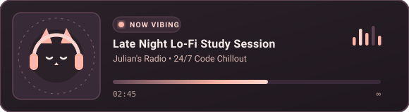
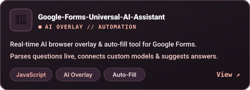
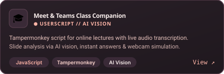
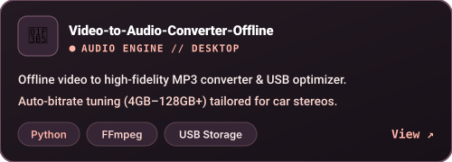
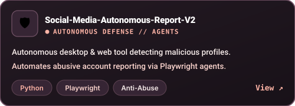
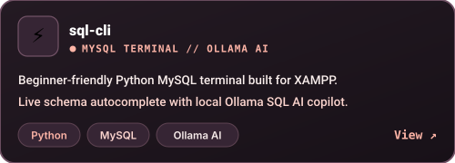
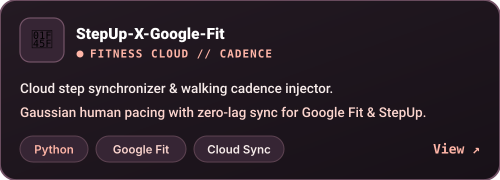

<!-- REP-JULIAN · COZY LO-FI PROFILE v4.0 (SOVEREIGN EDITION) | #2b2129 #5e4352 #ffb5a7 #fcd5ce #f8edeb -->

<!-- ═══════════════════ HERO BANNER (ANIMATED SVG) ═══════════════════ -->

  

<!-- Typing Subtitle -->

  

<!-- Quick Stats Badges -->

  
  &nbsp;
  
  &nbsp;
  

<!-- ═══════════════════ SPLIT INTRO: BIO & TERMINAL ═══════════════════ -->
<table align="center" width="100%">
  <tr>
    <td width="35%" align="center" valign="middle">
       
      
        
      <b style="color: #ffb5a7; font-size: 1.25rem;">Julian Agustino</b> 
      <samp style="color: #fcd5ce;">@REP-Julian</samp> 
      Developer · Student · Automation Craftsman
        
      

        Building AI automation tools, browser overlays, and desktop utilities with clean code and warm aesthetics.
      

      

        
        
      

    </td>
    <td width="65%" align="center" valign="middle">
      
    </td>
  </tr>
</table>

<!-- Live Lo-Fi Audio Card -->

  

<!-- ═══════════════════ TECH STACK MATRIX ═══════════════════ -->
<h2 align="center">🛠️ Technical Arsenal</h2>

<table align="center">
  <tr>
    <td align="center" valign="middle">
      <b>Automation, Languages &amp; Runtime</b>  
      
    </td>
  </tr>
  <tr>
    <td align="center" valign="middle">
      <b>Tools, Database &amp; Desktop Ecosystem</b>  
      
    </td>
  </tr>
</table>

<!-- ═══════════════════ FEATURED PROJECTS (BESPOKE SVG BENTO) ═══════════════════ -->
<h2 align="center">✨ Handcrafted Projects</h2>

Real code, live repositories, and continuous exploration.

<table align="center" width="100%">
  <tr>
    <td width="50%" align="center">
      
    </td>
    <td width="50%" align="center">
      
    </td>
  </tr>
  <tr>
    <td width="50%" align="center">
      
    </td>
    <td width="50%" align="center">
      
    </td>
  </tr>
  <tr>
    <td width="50%" align="center">
      
    </td>
    <td width="50%" align="center">
      
    </td>
  </tr>
</table>

<!-- ═══════════════════ TELEMETRY BENTO GRID ═══════════════════ -->
<h2 align="center">📊 System Telemetry &amp; Focus</h2>

  

  

<!-- ═══════════════════ LIVE DISPATCH: RECENT REPOSITORIES ═══════════════════ -->
<h2 align="center">⚡ Live Repository Dispatch</h2>

Auto-updated every 6 hours and whenever new repositories or commits are pushed.

<!-- AUTO_REPOS:START -->
<table align="center" width="100%">
  <thead>
    <tr style="border-bottom: 2px solid #5e4352;">
      <th align="left" style="color: #ffb5a7;">⚡ Repository</th>
      <th align="left" style="color: #ffb5a7;">Overview</th>
      <th align="center" style="color: #ffb5a7;">Stack</th>
      <th align="center" style="color: #ffb5a7;">Pushed</th>
    </tr>
  </thead>
  <tbody>
  <tr>
    <td><b><a href="https://github.com/REP-Julian/QCU-WEEK-2-PROJECT" style="color: #ffb5a7;">QCU-WEEK-2-PROJECT</a></b></td>
    <td style="color: #fcd5ce;">LESSON ON WEEK 2 PROJECT CC101</td>
    <td align="center"></td>
    <td align="center"><samp style="color: #f8edeb;">2025-09-06</samp></td>
  </tr>
  <tr>
    <td><b><a href="https://github.com/REP-Julian/PawTrackManagement" style="color: #ffb5a7;">PawTrackManagement</a></b></td>
    <td style="color: #fcd5ce;">This empasize the how pet treatly and help also the people want to adopt a animal ...</td>
    <td align="center"></td>
    <td align="center"><samp style="color: #f8edeb;">2025-11-27</samp></td>
  </tr>
  <tr>
    <td><b><a href="https://github.com/REP-Julian/Portfolio" style="color: #ffb5a7;">Portfolio</a></b></td>
    <td style="color: #fcd5ce;">No description provided.</td>
    <td align="center"></td>
    <td align="center"><samp style="color: #f8edeb;">2026-03-08</samp></td>
  </tr>
  <tr>
    <td><b><a href="https://github.com/REP-Julian/Calculator-project" style="color: #ffb5a7;">Calculator-project</a></b></td>
    <td style="color: #fcd5ce;">Project Report since Grade 11 </td>
    <td align="center"></td>
    <td align="center"><samp style="color: #f8edeb;">2026-03-08</samp></td>
  </tr>
  <tr>
    <td><b><a href="https://github.com/REP-Julian/Lost-and-Found" style="color: #ffb5a7;">Lost-and-Found</a></b></td>
    <td style="color: #fcd5ce;">The QCU Lost and Found is a lightweight, browser-based prototype designed for Quez...</td>
    <td align="center"></td>
    <td align="center"><samp style="color: #f8edeb;">2026-04-26</samp></td>
  </tr>
  </tbody>
</table>
<!-- AUTO_REPOS:END -->

<!-- ═══════════════════ ACTIVITY GARDEN ═══════════════════ -->
<h2 align="center">🌱 Contribution Garden</h2>

  <picture>
    <source media="(prefers-color-scheme: dark)" srcset="https://raw.githubusercontent.com/REP-Julian/REP-Julian/output/github-contribution-grid-snake-dark.svg" />
    <source media="(prefers-color-scheme: light)" srcset="https://raw.githubusercontent.com/REP-Julian/REP-Julian/output/github-contribution-grid-snake.svg" />
    
  </picture>

<!-- ═══════════════════ ENGINEERING PRINCIPLES ═══════════════════ -->
<h2 align="center">🎯 Engineering Mindset</h2>

<table align="center" width="100%">
  <tr>
    <td width="50%" valign="top">
      <h3 style="color: #ffb5a7;">📐 Architecture &amp; Craft</h3>
      <ul>
        <li>🧹 <b>Clean &amp; Intentional:</b> No dead code, no premature abstraction.</li>
        <li>🎨 <b>Aesthetic Ergonomics:</b> Accessible contrast, deliberate typography, smooth physics.</li>
        <li>⚡ <b>Reliable Deployments:</b> Self-contained assets that never break.</li>
      </ul>
    </td>
    <td width="50%" valign="top">
      <h3 style="color: #ffb5a7;">🐾 Motivation &amp; Routine</h3>
      <ul>
        <li>🌙 <b>Midnight Flow:</b> Highest focus unlocked between 22:00 and 02:00.</li>
        <li>☕ <b>Ritual:</b> Dark roast coffee + non-stop chill lo-fi radio.</li>
        <li>🌱 <b>Growth:</b> Compounding 1% improvements on every commit.</li>
      </ul>
    </td>
  </tr>
</table>

<!-- ═══════════════════ CONNECT & FOOTER ═══════════════════ -->
<h2 align="center">🤝 Let's Connect</h2>

Open for collaborations, UI discussions, and creative builds.

  
  &nbsp;
  
  &nbsp;
  
  &nbsp;
  

<i>Take it one commit at a time. ☕</i>

  

