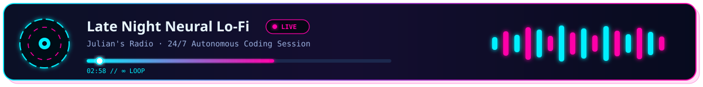

<!-- REP-JULIAN · CYBER-SOVEREIGN 3D PROFILE v5.0 | #050714 #0B1026 #00F0FF #FF00A8 #7B2CBF -->

<!-- ═══════════════════ 3D HOLOGRAPHIC HERO BANNER ═══════════════════ -->

  

<!-- Neon Typing Telemetry Subtitle -->

  

<!-- Holographic Status Badges -->

  
  &nbsp;
  
  &nbsp;
  

<!-- ═══════════════════ SPLIT IDENTITY & 3D TERMINAL HUD ═══════════════════ -->
<table align="center" width="100%">
  <tr>
    <td width="34%" align="center" valign="middle">
       
      
        
      <b>JULIAN AGUSTINO</b> 
      <code>@REP-Julian</code> 
      Developer · Student · Automation Craftsman
        
      Building AI automation tools, browser overlays, and desktop utilities engineered for speed and precision.
        
      
       
      
      
        
    </td>
    <td width="66%" align="center" valign="middle">
      
    </td>
  </tr>
</table>

<!-- Animated 3D Audio Spectrum Deck -->

  

<!-- ═══════════════════ TECH STACK MATRIX ═══════════════════ -->
<h2 align="center">⚡ TECHNICAL ARSENAL</h2>

<table align="center">
  <tr>
    <td align="center" valign="middle">
      <b>CORE LANGUAGES · AUTOMATION · RUNTIME</b>  
      
    </td>
  </tr>
  <tr>
    <td align="center" valign="middle">
      <b>INFRASTRUCTURE · DATABASE · DESIGN ECOSYSTEM</b>  
      
    </td>
  </tr>
</table>

<!-- ═══════════════════ 3D HOLOGRAPHIC PROJECT BENTO ═══════════════════ -->
<h2 align="center">🚀 DEPLOYED SYSTEMS &amp; BUILDS</h2>

Interactive 3D modules — click any holographic unit to inspect the live repository.

<table align="center" width="100%">
  <tr>
    <td width="50%" align="center">
      
    </td>
    <td width="50%" align="center">
      
    </td>
  </tr>
  <tr>
    <td width="50%" align="center">
      
    </td>
    <td width="50%" align="center">
      
    </td>
  </tr>
  <tr>
    <td width="50%" align="center">
      
    </td>
    <td width="50%" align="center">
      
    </td>
  </tr>
</table>

<!-- ═══════════════════ 3D SYSTEM TELEMETRY & STREAK ═══════════════════ -->
<h2 align="center">📡 SYSTEM TELEMETRY &amp; LIVE HORIZON</h2>

  

  

<!-- ═══════════════════ 3D ISOMETRIC CONTRIBUTION MATRIX ═══════════════════ -->
<h2 align="center">🌐 3D CONTRIBUTION MATRIX</h2>

  

  <picture>
    <source media="(prefers-color-scheme: dark)" srcset="https://raw.githubusercontent.com/REP-Julian/REP-Julian/output/github-contribution-grid-snake-dark.svg" />
    <source media="(prefers-color-scheme: light)" srcset="https://raw.githubusercontent.com/REP-Julian/REP-Julian/output/github-contribution-grid-snake.svg" />
    
  </picture>

<!-- ═══════════════════ ENGINEERING PROTOCOLS ═══════════════════ -->
<h2 align="center">🧠 ENGINEERING PROTOCOLS</h2>

<table align="center" width="100%">
  <tr>
    <td width="50%" valign="top">
      <h3>📐 Architecture &amp; Craft</h3>
      <ul>
        <li><b>Clean &amp; Intentional:</b> Zero dead code, zero premature abstraction.</li>
        <li><b>Aesthetic Ergonomics:</b> High-contrast cyber clarity, deliberate typography, smooth motion physics.</li>
        <li><b>Self-Contained Deployments:</b> Autonomous assets engineered to never break.</li>
      </ul>
    </td>
    <td width="50%" valign="top">
      <h3>⚡ Execution &amp; Routine</h3>
      <ul>
        <li><b>Midnight Overclock:</b> Peak deep-work flow unlocked between <code>22:00</code> and <code>02:00</code>.</li>
        <li><b>Ritual:</b> Dark roast coffee + continuous neural lo-fi radio.</li>
        <li><b>Compounding Velocity:</b> Iterative 1% upgrades pushed on every commit.</li>
      </ul>
    </td>
  </tr>
</table>

<!-- ═══════════════════ NEURAL UPLINK & FOOTER ═══════════════════ -->
<h2 align="center">🛰️ ESTABLISH UPLINK</h2>

Open for AI tooling collaborations, UI architecture, and ambitious builds.

  
  &nbsp;
  
  &nbsp;
  
  &nbsp;
  
  &nbsp;
  

<i>Take it one commit at a time. ⚡</i>

  

